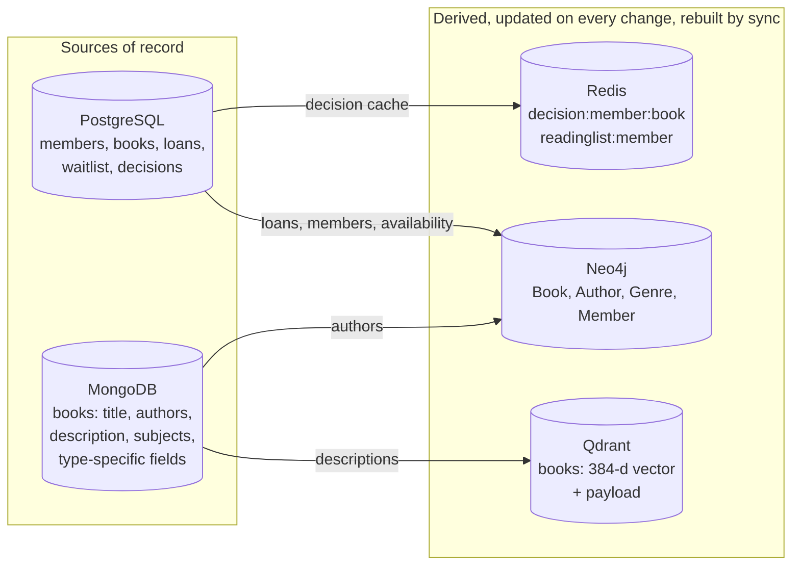
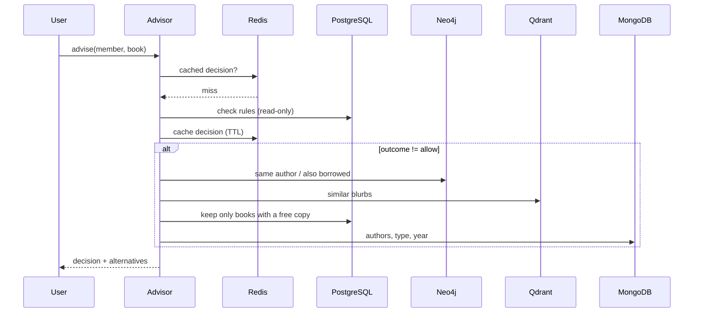

# ShelfSense – week-7 presentation

One program, five stores: a library loan advisor that answers **allow / waitlist / reject** for (member, book)
and suggests available alternatives. Data: 20,685 real Open Library books + synthetic members/loans.

## 1. Why each store (one reason each)

| Store | Role | Reason |
|---|---|---|
| PostgreSQL 16.4 | source of record | Loan rules need transactions and constraints (last-copy race, one active loan per member/book) |
| MongoDB 7.0.14 | source of record | Book records differ by type (paperback / ebook / journal) -> flexible documents with `$jsonSchema` per type |
| Redis 7.2.5 | derived | Cache of decisions (TTL 300 s) and reading lists (TTL 1800 s) |
| Neo4j 5.24.2 | derived | "Members who borrowed this also borrowed", same author: graph traversals |
| Qdrant 1.19.1 | derived | Semantic search over book blurbs (384-d MiniLM embeddings, cosine) |

Derived stores carry `source_id` (the book/member id) and `refreshed_at`; the Advisor keeps them in step with every change, and `shelfsense db sync` rebuilds them from scratch.

## 2. Data model of all stores

**PostgreSQL** (`books.id` = Open Library work id, used as key everywhere)
- `members(id, name, tier, max_loans, suspended)`
- `books(id, title, genre, year, book_type, available, total)` with `CHECK (available <= total)`
- `loans(id, member_id, book_id, loaned_at, due_at, returned_at)`, unique partial index: one active loan per member and book
- `waitlist(member_id, book_id, created_at)`, `decisions(id, member_id, book_id, outcome, reason, decided_at)`

**MongoDB** `books`: `_id` = book id, `title`, `authors[]`, `description`, `subjects[]`, `year`, `book_type`, plus fields by type
(paperback: pages, isbn; ebook: file_format, size_mb; journal: issn, volume, issue). Invalid inserts are rejected by the validator.

**Redis**: `decision:{member}:{book}` -> JSON `{outcome, reason, source_id, refreshed_at}` (TTL 300 s); `readinglist:{member}` set (TTL 1800 s, renewed on read).

**Neo4j**: `(:Member)-[:BORROWED]->(:Book)-[:BY]->(:Author)`, `(:Book)-[:IN_GENRE]->(:Genre)`; nodes have `source_id`, `refreshed_at`.

**Qdrant** collection `books`: vector 384 (cosine), payload `{source_id, title, genre, year, refreshed_at}`, payload indexes on `genre` (keyword) and `year` (integer).
Point id = uuid5(book id), because Qdrant ids must be UUID/int.

## 3. Request flow

Write path `borrow()`: one Postgres transaction (`SELECT ... FOR UPDATE` on the book row, update, loan, decision row), then delete the cached decisions of that book in Redis and add the `BORROWED` edge in Neo4j.
`return_book()`: one transaction closes the loan and gives the copy to the first eligible waitlisted member; Redis is invalidated, the edge is marked returned (and created for the promoted member).
Book add / edit / delete: PostgreSQL + MongoDB, then the Neo4j node and the single Qdrant point (re-embedded only if title or description changed). Derived stores are updated right after the commit; `sync` is only the full rebuild.

Loan rules, first match wins: suspended -> at max loans -> already holds book -> already on waitlist -> journal for standard tier -> no copy (waitlist) -> allow.

## 4. Vector search

- Text = title + description, model `all-MiniLM-L6-v2`, normalised, cosine, 20,685 vectors.
- HNSW with `m=16`, `ef_construct=100`; default thresholds, but `default_segment_number=1` (the default of one segment per CPU splits 20k vectors below the index threshold, which left `indexed_vectors = 0`). After the fix 15,104 of 20,685 vectors are indexed (2 segments).
- Search = Qdrant top-k (optional `genre` / `year` filter) -> Postgres availability (one SQL join, `eval/demo_join.py`) -> Mongo details.
- Results (`report/results.txt`, from `shelfsense eval all`): recall@5 0.73, MRR 0.846 (20 queries); ANN recall@10 vs exact: 0.945 at `hnsw_ef`=16, 0.995 at 64, 1.0 at 128.
- Filter keeping 48% of rows (`year >= 1998`, above `full_scan_threshold`, so HNSW is really used): recall@10 0.85 / 0.99 / 0.99 at `hnsw_ef` 16 / 64 / 128 -> filtering needs a larger `hnsw_ef`.
- Caveat: a filter keeping 4.4% of rows (`year >= 2009`, 908 rows) is below `full_scan_threshold`, so Qdrant probably answers it by exact scan; recall 1.0 there is not an HNSW result.
- Caveat: latency is 2-4.5 ms for ANN and exact (ANN about 1.2-1.4x faster on unfiltered/48%), dominated by Docker/WSL round trips; not a proven speedup.
- Deviation: no pgvector, so no head-to-head comparison (Qdrant only, by choice).

## 5. Measurement plan

All numbers in the report are printed by code; tests and labels are written before tuning.

| What | How | Code |
|---|---|---|
| Decision correctness | 15 labelled loan cases on scenario members/books | `tests/test_sources.py`, `tests/test_decision.py` |
| Retrieval quality | 20 interest queries, relevance by fixed regex rules; recall@5 (capped by min(5, #relevant)), MRR | `eval/eval_vectors.py` |
| ANN vs exact | recall@10 of Qdrant ANN against `exact=True`, `hnsw_ef` 16/64/128, no filter, ~5% filter and ~50% filter | `eval/eval_vectors.py` |
| Qdrant + Postgres join | top-10 ids joined to availability in one statement | `eval/demo_join.py` |
| Concurrency | 20 rounds, two members, last copy -> exactly one allow (result 20/20) | `eval/demo_concurrency.py` |
| Update across stores | edit a book, borrow, return, add, delete through the Advisor; Redis entry dropped, Neo4j and Qdrant follow immediately (one point re-embedded) | `eval/demo_update_across.py` |
| Failure case | stale Redis decision after Postgres changed without invalidation (max 300 s) | `eval/demo_stale_cache.py` |

All of it runs with `shelfsense eval all` (output: `report/results.txt`, `results.json`). The 46 tests use separate test databases.
Parameters varied: `hnsw_ef` (16/64/128) and filter share (none / 4.4% / 48%).
Deviations from the PDF: 20k books instead of 200-1,000 records (so default HNSW thresholds apply); Qdrant only, no pgvector.

## 6. The application
`shelfsense` CLI (`advise`, `borrow`, `return`, `recommend`, `similar`, `search`, `book add|edit|delete`, `db`, `data`, `eval`, `test`) and a full-screen TUI with tabs Advise (rule trace), Recommend, Book (view per store), Member, Librarian (return + waitlist promotion), Stores (health, counts, cache), Scenarios (15 loan cases) and Demos. Demo scenarios: `TEST_CASES.md`.

## 7. Talking points / risks
- Genres of 20k books are keyword heuristics (noisy; horror, fantasy and cooking are thin).
- Book type, copies and loans are synthetic.
- Neo4j and Qdrant follow every borrow, return and book change at once; if one of them is down the change stays in PostgreSQL/MongoDB and `sync` repairs it. Redis is invalidated explicitly, but only after commit.
