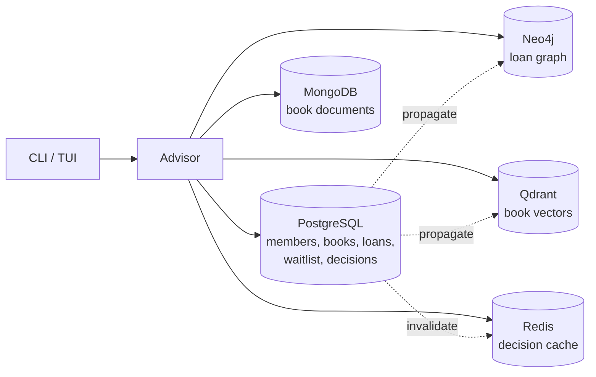

# 1. Recap: Project 1 (state at tag `v1`)

**What ShelfSense is.** A library loan advisor. For a (member, book) pair it answers **allow / waitlist / reject**, gives the reason,
and suggests **alternatives that have a free copy**. The point of the project: every database does the job it is best at, and all of them stay consistent.

**Data.** 20,685 Open Library books (CC0) + generated members (3,006), loans (24,691), waitlist entries (401).

**Base structure.**

| Store | Role in v1 |
|---|---|
| PostgreSQL | **source of record**: transactions, `CHECK (available>=0)`, one active loan per member+book, row lock on borrow |
| MongoDB | book documents whose fields differ by type (ebook `size_mb`, journal `issn`), `$jsonSchema` validation |
| Redis | decision cache, TTL 300 s |
| Neo4j | derived: "also borrowed" and "same author" |
| Qdrant | derived: meaning search over 384-d MiniLM embeddings, HNSW, metadata filters |

Already in v1: live propagation (borrow/return -> Neo4j, book add/change/delete -> re-embed only that book), 15 loan test cases, 20 retrieval queries, concurrency test (20/20), 46 tests.

**v1 measurements (baseline):** loan cases 15/15 · recall@5 0.73 · MRR 0.846 · Qdrant ANN recall@10 0.945 / 0.995 / 1.0 (ef 16/64/128) · concurrency 20/20.

\newpage

# 2. Why Project 2 needed changes

The v1 app worked on the happy path, but an honest review against the Project II requirements showed **six weaknesses**:

| # | Weakness in v1 | Consequence |
|---|---|---|
| 1 | Loan rules hard-coded in Python | A rule change rewrites history: nobody can tell which rule produced an old decision |
| 2 | Unknown member/book = exception | Missing evidence is crashing, not a decision; nothing stored, nothing to audit |
| 3 | Decisions not explainable later | "Why was I rejected last week?" cannot be answered |
| 4 | Only vector search, only Qdrant | Exact words (names, codes) are blurred by embeddings; no evidence Qdrant was the right choice over pgvector |
| 5 | Derived copies (Neo4j, Qdrant, ...) could silently drift | A missed update was invisible; the only repair was a full 20,000-book re-sync |
| 6 | Few negative/safety tests, labels could be tuned after the fact | Weak trust in the measurements |

**Principle used for every change:** keep the v1 architecture (PostgreSQL + MongoDB are the truth, the rest is derived), and make each change **visible in a measurement or a demo**.
Each change below has: *what / why / effect / limit*.

\newpage

# 3. Change A – Versioned rules and a decision trail

**What.** Loan rules moved out of code into the PostgreSQL table `rules` (version, JSON parameters, valid-from/to; a unique partial index allows only one active version).
Parameters in v1: loan period 21 days, max loans 3 (standard) / 6 (premium), journals only for premium.
Every decision row now stores `rule_version`, `rule_id` (which rule decided, e.g. `r2_limit`) and `inputs` (JSONB: member id/version/tier/suspended, book id/version/type/available, active loans, waitlist flags).
Rules are a pure function: `rules.evaluate(inputs, params)`.

**Why.** Rules change over time; a decision is only meaningful together with the rule version and the evidence it was made from.

**Effect (demo `eval rules`).**

| Step | Result |
|---|---|
| Rules v1, member `S_FULL` (3 loans) asks `free1` | **reject**, rule `r2_limit` (decision #1) |
| Publish v2: standard limit 4 (cache is invalidated) | – |
| Same request | **allow**, rule `r6_available` (decision #2) |
| `explain 1` after the change | still shows **v1** (active now: v2), replay gives *reject* – `replay_ok` |

**Improvement.** Rule changes are now data changes, auditable and reversible; old decisions never become wrong retroactively.
**Limit.** Only parameters are versioned; a new kind of rule still needs code.

\newpage

# 4. Change B – `needs_info` instead of errors

**What.** A fourth outcome. If the member or book is unknown, the advisor does not guess and does not crash: it stores a decision `needs_info` with the reason and the inputs it could read.
Table constraint and CLI/TUI updated; the TUI shows it as a distinct verdict.

**Why.** "Missing evidence" is a legitimate answer in a loan process (typo, deleted book), and a system that decides must not invent an answer.

**Effect.**

- 24 hostile ids (12 strings as member and as book: SQL injection `'; DROP TABLE`, Cypher injection, empty, NUL byte, very long, unicode) -> `needs_info`, **row counts of all tables unchanged**.
- 3 unknown-id cases stored as decisions; before: exception, nothing stored.

**Improvement.** No crashes on bad input; every request leaves an audit row. **Limit.** A misspelled id that happens to exist is simply another member – no fuzzy matching.

# 5. Change C – Explain a decision later

**What.** `shelfsense explain <decision-id>` (and the TUI: Librarian tab -> Enter on a decision) takes the **stored inputs** and the **stored rule version**, re-runs the rules, and prints the pass/fail trace and whether the replay reproduces the stored outcome. A live variant `explain <member> <book>` shows the trace for a request without storing it.

**Why.** Explainability was a core requirement, and it is only possible because of Changes A and B (version + inputs are stored).

**Effect.** Decision #1 (above) is explained correctly after rules moved on to v2; all replays in the test suite reproduce their stored outcome.

\newpage

# 6. Change D – pgvector next to Qdrant (and a fair comparison)

**What.** The same 20,000 vectors (384-d) are also stored in PostgreSQL with **pgvector 0.8** (HNSW, m=16, ef_construct=100 – the same parameters as Qdrant, iterative scan on for filters). `eval compare` runs both on the same 20 queries.

**Why.** In v1 Qdrant was chosen without an alternative to compare against. The honest question: *when is a dedicated vector store worth it versus PostgreSQL alone?*

**Effect (20,000 vectors, recall@10 of ANN against exact search; median ms ANN / exact).**

| Setting | Qdrant | pgvector |
|---|---|---|
| answer quality (recall@5 / MRR) | 0.73 / 0.821 | 0.73 / 0.821, top-10 overlap **1.0** |
| no filter, ef 16 / 64 / 128 | 0.985 / 1.0 / 1.0 · 2.7–3.0 vs 3.5 ms | 0.925 / 1.0 / 1.0 · 1.3–2.2 vs 8.7–9.0 ms |
| filter keeping 3.9% | 1.0 | 0.985–0.99 |
| filter keeping 48.7% | 0.865 / 0.96 / 0.99 | 0.955 / 0.995 / 0.995 |
| index size | HNSW m=16 | 41 MB |

**Reading.** Identical answers. pgvector's ANN is 4–6x faster than its own exact scan; Qdrant's exact search is already fast at this size. At a 48.7% filter Qdrant needs `ef>=64`; pgvector with iterative scan stays above 0.95. The 3.9% filter (788 rows) is below Qdrant's `full_scan_threshold`, so both effectively scan – that row says nothing about HNSW.

**Improvement.** The choice is now evidence-based: at 20,000 vectors PostgreSQL alone is a valid alternative; Qdrant gives a dedicated filter engine and index tuning, pgvector gives one less service and transactional consistency.
**Limit.** One embedding model; latencies include Docker/WSL round trips, not production figures.

\newpage

# 7. Change E – Hybrid search (keyword + vector)

**What.** A PostgreSQL full-text index (`to_tsvector('english')`, `ts_rank_cd`) over title/author/description, and **reciprocal rank fusion** (K=60) of the keyword list and the Qdrant list. CLI: `recommend "<text>" --mode vector|keyword|hybrid`.

**Why.** Embeddings find meaning but blur exact words; keywords find words but miss paraphrases. Weak queries in v1 (5, 6, 10, 18, 20 at recall@5 0.4 or lower) had exactly this pattern.

**Effect (20 frozen queries, `eval hybrid`).**

| Mode | recall@5 | MRR | median latency |
|---|---|---|---|
| vector (v1 behaviour) | 0.73 | 0.821 | 4.2 ms |
| keyword | 0.51 | 0.677 | 22.8 ms |
| **hybrid** | **0.76** | **0.925** | 29.1 ms |

Example: "coming-of-age adventure for young readers" – first relevant book at rank **3** for vector, **1** for keyword and hybrid.

**Improvement.** MRR +0.10 (first good answer is usually first), recall@5 +0.03; costs ~25 ms.
**Limit.** Labels are regex rules, which partly favour keyword matching; read the gain as "hybrid is at least as good and more robust", not as an absolute truth.
*Note on v1's 0.846:* v1 used 20,685 books; the dataset was rebuilt to 20,000, so vector MRR 0.821 reflects a different corpus, not a regression of the method.

\newpage

# 8. Change F – Derived-copy registry and `refresh`

**What.** A table `derived_state` records, per store and book, the source version each copy was built from. PostgreSQL triggers raise a row `version` whenever title, genre, year or type change (not on `available`). `db derived` shows current / **stale** / missing / orphan per store (Neo4j, Qdrant, pgvector, full text); `db refresh` re-indexes **only the stale books**.

**Why.** Five stores = four copies that can drift. In v1 a missed update was invisible and the only repair was a full 20,000-book re-sync (minutes).

**Effect (demo `eval stale`, one temporary book).**

| State | Source | Neo4j / Qdrant / pgvector / FTS | Search for new text |
|---|---|---|---|
| 1. before | v1 | v1, all current | miss |
| 2. source changed, propagation off | **v2** | v1, all **STALE** | miss (vector and keyword) |
| 3. after `refresh` (0.3 s, 1 book) | v2 | v2, all current | **hit** (vector and keyword) |

End state of the real data: 20,000 current rows per store, 0 stale, 0 missing, 0 orphans.

**Improvement.** A silent inconsistency became a visible, measurable, cheaply repairable state: 0.3 s instead of a full re-sync.
**Limit.** Detection is by version, not content comparison. Redis is not in the registry (it expires by TTL).

\newpage

# 9. Change G – Safety, concurrency and data checks

**What.**

- `tests/test_safety.py` – **34 tests**: 24 hostile ids, unknown ids, suspended member, borrowing the same book twice (one loan), waiting three times (one waitlist row), **4 threads** borrowing for one member (exactly one allow), double return, return without loan, duplicate book id.
- `shelfsense db check` – **21 data checks** across stores: counts agree, no negative availability, no duplicate active loans, Neo4j edges = distinct PostgreSQL member–book pairs, registry complete, labels unchanged. Non-zero exit code on failure.
- A test teardown that restores the demo members' graph edges to the PostgreSQL truth.

**Why.** A multi-store system fails in the gaps between stores; checks and negative tests are the only way to claim consistency.

**Effect.** The checks found real problems during development: a leaked test edge in Neo4j (fixed by the teardown), and 37 title+year duplicates that are distinct Open Library works (downgraded to a warning). Result now: **21/21 checks, 34/34 safety tests, 108 tests in total** (v1: 46).

# 10. Change H – Frozen evaluation labels

**What.** The 20 retrieval queries (with relevance rules) and 15 loan cases were written before tuning and are now **locked with SHA-256 hashes** (`data/labels/labels.lock.json`); regenerating needs `--force`, and `eval labels` / `db check` verify them.

**Why.** If labels can change, any improvement could be fitted to the test. Frozen labels make the numbers in this presentation trustworthy.

\newpage

# 11. Change I – Orchestration, TUI and docs

- **`eval all`** runs everything (labels, hybrid, comparison, rules demo, stale demo, safety tests, data checks) and writes `report/results.txt` / `results.json` – every number here comes from that file.
- **TUI** Librarian tab: explain panel for any stored decision.
- **CLI** new commands: `rules list|show|publish`, `explain`, `recommend --mode`, `db check|derived|refresh|pgvector`, `eval hybrid|compare|rules|stale|labels`.
- README, TEST_CASES (48 cases), report and this presentation updated.

# 12. Summary of measurements: before vs after

| Measure | v1 | Now | Cause |
|---|---|---|---|
| Loan cases correct | 15/15 | 15/15 | unchanged (frozen) |
| Concurrency rounds | 20/20 | 20/20 | unchanged |
| Retrieval MRR | 0.846 (20,685 books) | vector 0.821 -> **hybrid 0.925** (20,000 books) | Change E |
| Retrieval recall@5 | 0.73 | 0.73 -> **0.76** hybrid | Change E |
| Vector stores compared | 1 (Qdrant) | 2, overlap 1.0 | Change D |
| Missed-update repair | full re-sync (minutes) | 0.3 s per book, visible as STALE | Change F |
| Unknown / hostile input | exception | stored `needs_info`, 0 rows changed | Change B |
| Old decision explainable | no | yes, with `replay_ok` | A, C |
| Automated tests | 46 | **108** (+34 safety, 21 data checks) | G |

\newpage

# 13. Why each store (and what PostgreSQL alone could do)

| Store | Main query | Why here | Simpler alternative |
|---|---|---|---|
| PostgreSQL | borrow in **one transaction**, `SELECT … FOR UPDATE` on the book | atomic changes, constraints, rules, decisions | – (source of truth) |
| MongoDB | `find_one({_id})`, `$jsonSchema` per book type | different fields per type, whole document read/written together | PostgreSQL JSONB, with less convenient per-type validation |
| Redis | `GET decision:{member}:{book}`, TTL 300 s | key lookup, self-expiring cache | a PostgreSQL cache table + cleanup job |
| Neo4j | `(:Book)<-[:BORROWED]-(:Member)-[:BORROWED]->(o)` | relationship pattern in one line | **a self join on `loans`** (works at this size) |
| Qdrant / pgvector | cosine top-k + filter | meaning search | each other (Change D) |
| PostgreSQL FTS | `tsvector @@ tsquery`, `ts_rank_cd` | exact words | – |

**Honest PostgreSQL-alone alternative:** "also borrowed" as a self join on `loans`. Neo4j gives a shorter query and room for longer paths, and costs a second copy that can drift – which Change F and the checks now control.

# 14. Demo plan (5 minutes) and honest limits

**Demo:** (1) `db derived` – all stores current · (2) `advise S_FULL free1` -> reject, `rules publish` v2 -> allow · (3) `explain 1` · (4) `recommend … --mode hybrid` · (5) `eval stale` · (6) TUI explain panel.

**Limits to say out loud.**

- Labels are regex rules (an approximation of human judgement; keyword/hybrid may profit).
- Book types, copies and loans are synthetic; 20,000 vectors is small for vector-database claims.
- Rule versioning covers parameters, not new logic; one lock per book (no multi-server locking).
- Latencies run on Docker in WSL on a laptop.

**Take-away.** v1 proved that five databases can cooperate. Project 2 made that cooperation **accountable**: every decision is versioned and explainable, every copy shows whether it is current, and every claim is backed by a frozen test.
